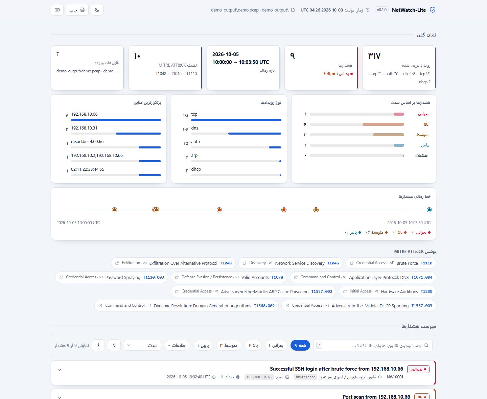
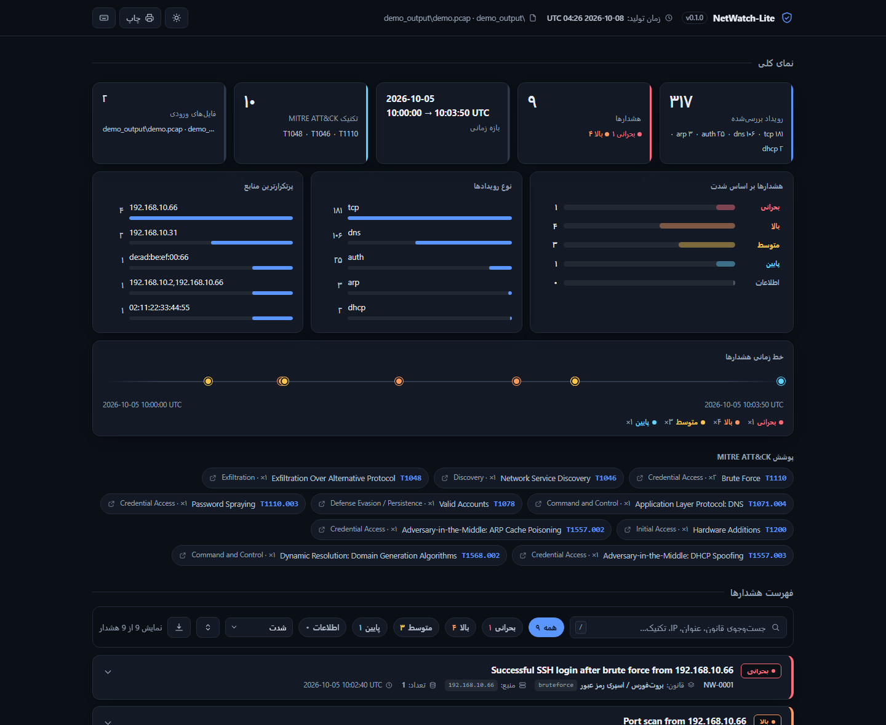
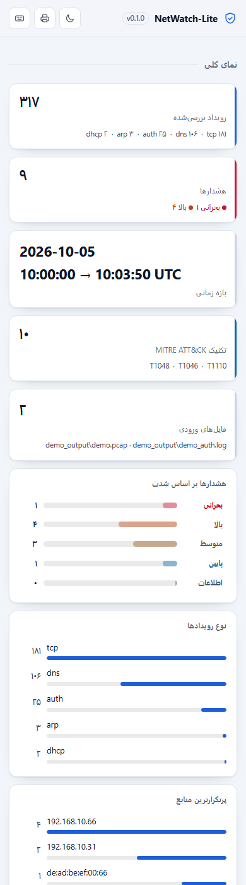
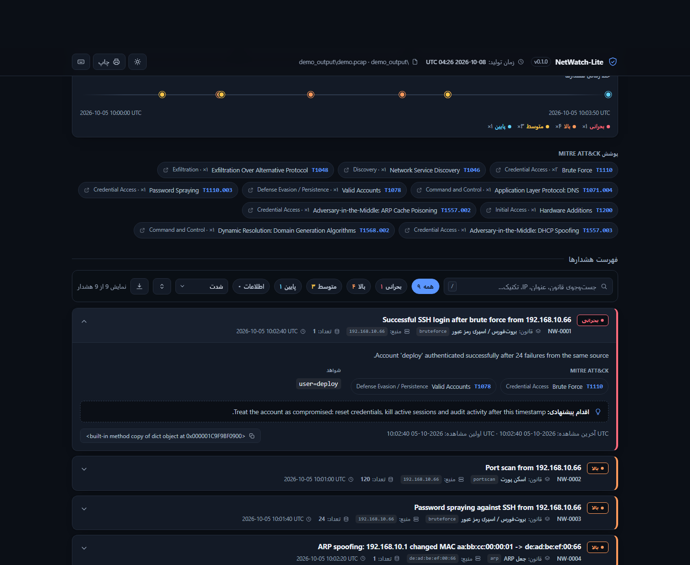

# NetWatch-Lite

[](https://github.com/M4TECHG/netwatch-lite/actions)


**فارسی | [English](#english)**

ابزار سبک و متن‌باز برای **تشخیص تهدید در شبکه**. فایل‌های **PCAP (Wireshark)** و **لاگ‌های احراز هویت** را تحلیل می‌کند، هشدارها را به **MITRE ATT&CK** نگاشت می‌کند، یک گزارش **HTML تعاملی** می‌سازد و می‌تواند هشدارها را به **Splunk HEC** یا یک webhook بفرستد. برای کار روزمرهٔ **SOC سطح ۱**، مدیران IT سازمان‌های کوچک و تمرین تیم آبی ساخته شده است.

<p align="center">
  
</p>

## قابلیت‌ها

| تشخیص | توضیح | MITRE |
|---|---|---|
| Port Scan | اسکن پورت با بسته‌های SYN به مقادیر زیاد (میزبان، پورت) | T1046 |
| Brute Force / Password Spraying | از لاگ SSH یا نرخ اتصال در PCAP؛ **ورود موفق بعد از حمله = Critical** | T1110, T1078 |
| DNS Tunneling و DGA | آنتروپی نام‌ها، زیرداینامین یکتا، حجم TXT/NULL | T1071.004, T1568.002 |
| ARP Spoofing | تغییر نگاشت IP به MAC (به‌ویژه گیت‌وی) | T1557.002 |
| Rogue DHCP | سرور DHCP غیرمجاز روی شبکه | T1557.003 |
| دستگاه ناشناس | MAC خارج از فهرست دارایی‌ها | T1200 |

منطق تشخیص، آستانه‌ها و **محدودیت‌های شناخته‌شده** در [docs/detections.md](docs/detections.md) آمده است.

## نصب و اجرای سریع

```bash
git clone https://github.com/M4TECHG/netwatch-lite
cd netwatch-lite
pip install -e .
netwatch demo --out demo_output --lang fa
```

سپس `demo_output/report.html` را در مرورگر باز کنید. خروجی واقعی کنسول:

```text
NetWatch-Lite 0.1.0 - 317 events - 9 alerts - 2026-10-05 10:00:00 UTC -> 2026-10-05 10:03:50 UTC

  CRITICAL NW-0001  bruteforce  192.168.10.66               T1110,T1078       x1     Successful SSH login after brute force from 192.168.10.66
  HIGH     NW-0002  portscan    192.168.10.66               T1046             x120   Port scan from 192.168.10.66
  HIGH     NW-0003  bruteforce  192.168.10.66               T1110.003         x24    Password spraying against SSH from 192.168.10.66
  HIGH     NW-0004  arp         de:ad:be:ef:00:66           T1557.002         x1     ARP spoofing: 192.168.10.1 changed MAC aa:bb:cc:00:00:01 -> de:ad:be:ef:00:66
  HIGH     NW-0005  dns         192.168.10.31               T1071.004,T1048   x80    Possible DNS tunnelling to evil-tunnel.com from 192.168.10.31
  MEDIUM   NW-0006  rogue_dhcp  192.168.10.2,192.168.10.66  T1557.003         x1     Multiple DHCP servers answering on the same network
  MEDIUM   NW-0007  bruteforce  192.168.10.66               T1110             x41    Possible brute force on 192.168.10.5:22 from 192.168.10.66
  MEDIUM   NW-0008  dns         192.168.10.31               T1568.002         x6     DGA-like domain lookups from 192.168.10.31
  LOW      NW-0009  new_device  02:11:22:33:44:55           T1200             x1     Unknown device 02:11:22:33:44:55

  report: demo_output/report.html
```

## گزارش HTML

گزارش یک فایل **تک‌فایلی** است: HTML + CSS + JS در یک فایل، بدون CDN و بدون درخواست شبکه‌ای، پس آفلاین و در شبکهٔ داخلی هم کار می‌کند.

<p align="center">
  
  
</p>

- **فیلتر و جست‌جو:** چیپ‌های شدت (بحرانی/بالا/متوسط/پایین/اطلاعات) + جست‌وجوی فوری در عنوان، منبع، قانون و شناسه.
- **چهار حالت مرتب‌سازی:** شدت، زمان، تعداد تکرار، نام قانون.
- **کیبورد:** `/` جست‌جو · `؟` راهنما · `0`–`5` فیلتر شدت · `t` مرتب‌سازی زمان · `e` باز و بسته کردن همه.
- **خط زمانی هشدارها** با رنگ شدت، **نوار شدت**، **نوار انواع رویداد و منابع** و **چیپ‌های MITRE ATT&CK**.
- **هر هشدار یک کارت جمع‌شونده** با جزئیات رویدادهای مرتبط.
- **دو حالت روشن/تیره** با ذخیره در مرورگر، و `?theme=dark` برای لینک‌دادن نسخهٔ مشخص.
- **RTL و ارقام فارسی** در نسخهٔ فارسی، **چاپ‌پذیر** (استایل print) و **واکنش‌گرا** از ۳۶۰ تا ۱۶۰۰ پیکسل.
- دسترس‌پذیری: ترتیب صحیح هدرها، `aria-pressed` روی چیپ‌ها، `aria-live` روی شمارنده، و اسکرین‌ریدر-دوستانه.

<p align="center">
  
</p>

## استفاده روی دادهٔ خودتان

```bash
netwatch analyze capture.pcap auth.log -c rules/default.yaml --inventory inventory.csv \
    --html report.html --json report.json --lang fa --fail-on high
```

- قالب لاگ: syslog مربوط به OpenSSH، یا CSV با ستون‌های `ts,service,user,src_ip,result`، یا JSON Lines.
- `--inventory` فایلی از MACهای شناخته‌شده است و قانون `new_device` را فعال می‌کند.
- ارسال به Splunk: [docs/splunk.md](docs/splunk.md)

## مرجع دستورات

```text
netwatch demo [--out DIR] [--lang {en,fa}]
netwatch analyze FILE... [options]
netwatch --version
```

| گزینه | توضیح |
|---|---|
| `-c`, `--config FILE` | فایل قوانین YAML (پیش‌فرض: `rules/default.yaml`) |
| `--inventory FILE` | فهرست دستگاه‌های شناخته‌شده (CSV/TXT) |
| `--year YYYY` | سال برای زمان‌های syslog |
| `--html FILE` | گزارش HTML تعاملی |
| `--json FILE` | گزارش JSON |
| `--csv FILE` | صف هشدارها به‌صورت CSV |
| `--lang {en,fa}` | زبان گزارش HTML (پیش‌فرض `en`) |
| `--min-severity` | کمترین شدتی که در کنسول چاپ می‌شود (پیش‌فرض `low`) |
| `--fail-on` | اگر هشداری به این شدت یا بالاتر وجود داشت، کد خروج `2` |
| `--splunk-url`, `--splunk-token`, `--splunk-index` | ارسال به Splunk HEC |
| `--splunk-insecure` | نادیده‌گرفتن اعتبارسنجی TLS (فقط در آزمایشگاه) |
| `--splunk-dry-run` | چاپ payload به‌جای ارسال |
| `--webhook-url`, `--webhook-dry-run` | POST کردن گزارش JSON به یک webhook |
| `-q`, `--verbose` | خروجی ماشین‌خوان / جزئیات بیشتر (قبل یا بعد از زیرفرمان) |
| `--version` | نسخه |

### کد خروج

| کد | معنی |
|---|---|
| `0` | اتمام موفق؛ هشداری به آستانهٔ `--fail-on` نرسیده |
| `1` | ورودی نامعتبر یا خطای اجرا (خطاهای argparse هم `1` هستند تا با `2` قاطی نشوند) |
| `2` | هشداری به آستانهٔ `--fail-on` رسید — همین کد را در CI چک کنید |
| `130` | وقفه با Ctrl+C |

`NO_COLOR` رنگ‌ها را خاموش می‌کند و `FORCE_COLOR=1` آن‌ها را حتی در لوله (pipe) روشن نگه می‌دارد.

```bash
netwatch analyze capture.pcap --fail-on high      # در CI: خروجی 2 یعنی «هشدار جدی داریم»
```

## معماری

```text
PCAP / auth.log ──► parsers ──► Event (نرمال‌شده) ──► detectors (streaming، پنجرهٔ لغزان)
                                                        │
                                  Alerts + MITRE ◄──────┘──► HTML / JSON / CSV / Splunk HEC / webhook
```

هر Detector مستقل است و فقط یک جریان رویداد را مصرف می‌کند؛ حافظهٔ مصرفی روی PCAPهای بزرگ ثابت می‌ماند. آستانه‌ها در `rules/default.yaml` قابل تنظیم‌اند و اضافه‌کردن قانون جدید در [CONTRIBUTING.md](CONTRIBUTING.md) توضیح داده شده است.

## نکات امنیتی و اخلاقی

- فقط روی شبکه‌ها و داده‌هایی استفاده کنید که اجازهٔ دسترسی دارید. لاگ یا PCAP واقعی سازمان را در مخزن عمومی قرار ندهید.
- هشدارها نیاز به بررسی انسانی دارند؛ آستانه‌ها را با شبکهٔ خودتان تنظیم کنید.
- گزارش‌ها ممکن است IP، نام میزبان و نام کاربری داشته باشند؛ پیش از انتشار عمومی بازبینی کنید.

## نقشهٔ راه

- [ ] ضبط زنده با `--iface`
- [ ] پشتیبانی از IPv6
- [ ] قوانین Sigma
- [ ] تحلیل TLS/JA3
- [ ] فهرست Public Suffix کامل
- [ ] پارسر لاگ فایروال و Windows Event 4625

## مشارکت

پیش از PR، `ruff check .`، `ruff format --check .` و `python -m pytest -q` باید سبز باشند. جزئیات در [CONTRIBUTING.md](CONTRIBUTING.md) و گزارش مشکل از قالب‌های [Issue](https://github.com/M4TECHG/netwatch-lite/issues) قابل انجام است. امنیت را از [SECURITY.md](SECURITY.md) اعلام کنید.

---

## English

NetWatch-Lite is a lightweight, self-contained blue-team tool. It analyses **PCAP** files and **authentication logs**, detects port scans, brute force and password spraying, DNS tunnelling and DGA, ARP spoofing, rogue DHCP servers and unknown devices, maps every finding to **MITRE ATT&CK**, renders an **interactive HTML report (EN/FA)** and exports alerts to **Splunk HEC** or a generic webhook.

```bash
git clone https://github.com/M4TECHG/netwatch-lite
cd netwatch-lite
pip install -e .
netwatch demo --out demo_output              # synthetic attacks -> alerts -> demo_output/report.html
netwatch analyze capture.pcap auth.log --html report.html --fail-on high
```

The HTML report is a single offline file: no CDN, no network calls, dark/light themes, full-text search, severity filters, keyboard shortcuts and a responsive RTL layout. See [docs/detections.md](docs/detections.md) for the detection logic and its known limitations.

Exit codes are part of the contract: `0` ok, `1` error, `2` threshold reached via `--fail-on`, `130` interrupted.

## توسعه

```bash
pip install -e ".[dev]"
ruff check . && ruff format --check . && python -m pytest -q
python scripts/check_report.py demo_output/report.html --shots assets   # رندر گزارش در مرورگر (نیازمند Playwright)
```

## License

MIT © Mir Mohammad Mousavi
